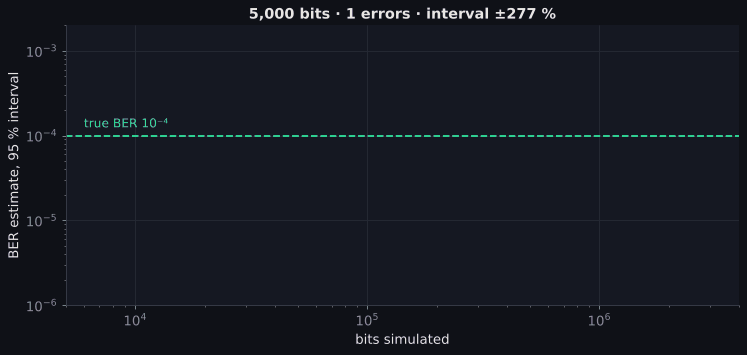
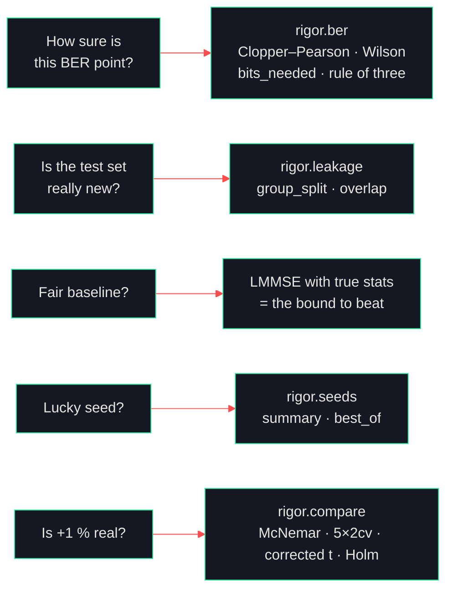
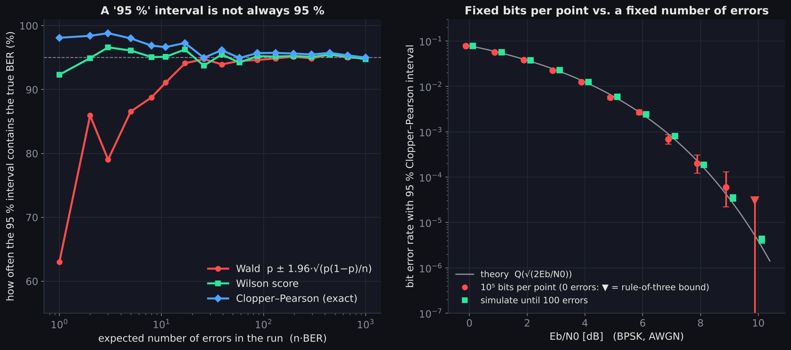
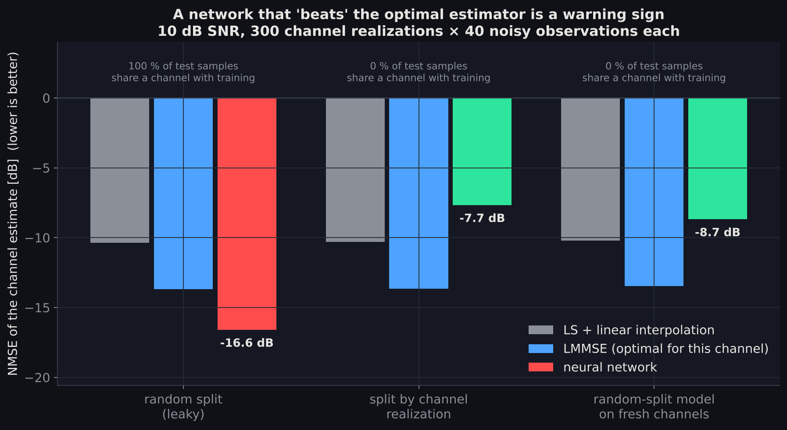
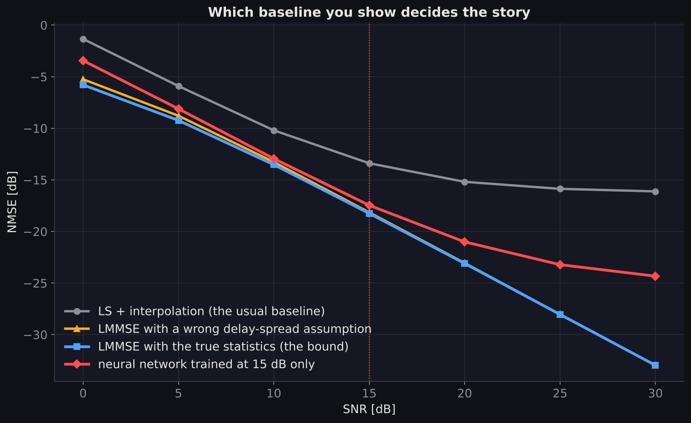
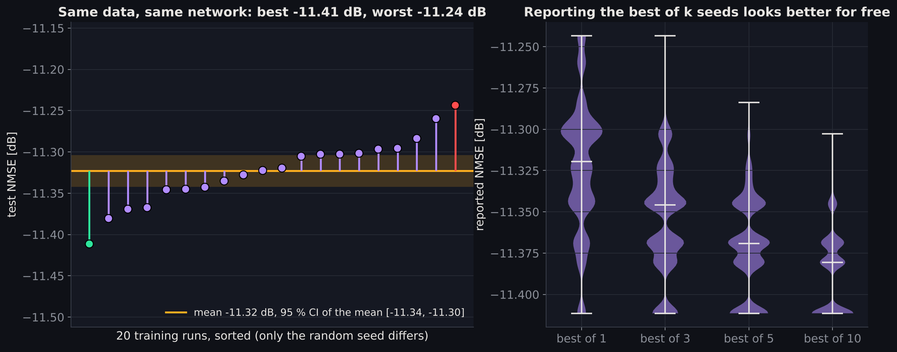
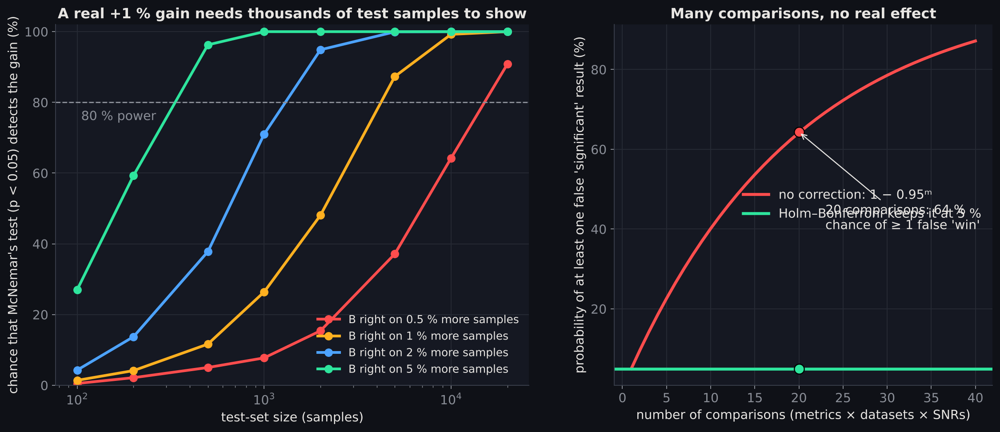
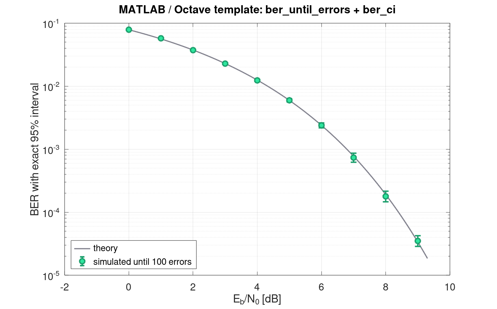

<p align="center"></p>

<p align="center">


</p>

<h3 align="center">"How many errors did you count at that point?" "Is the test set independent?" "Did you try other seeds?"<br>The questions reviewers ask, each answered with a simulation you can run.</h3>

Most rejections of simulation papers in communications and machine learning are not about the idea. They are about the numbers: a BER point measured from three errors, a neural network that has seen the test channels during training, a baseline nobody would use in practice, a 0.2 dB gain inside the noise of the random seed. This repository shows each problem happening, measures how large it is, and gives the fix as a small tested library (`rigor/`, Python) and drop-in templates (`matlab/`).

<table>
<tr>
<td align="center" width="25%"><h2>79 %</h2><sub>real coverage of the textbook<br>"95 %" interval when the run<br>has 3 errors (exact: 98.8 %)</sub></td>
<td align="center" width="25%"><h2>−16.6 dB</h2><sub>a network that "beats" the<br>optimal LMMSE (−13.7 dB)<br>— because of a leaky split</sub></td>
<td align="center" width="25%"><h2>26 %</h2><sub>chance that a real +1 % accuracy<br>gain is significant on a<br>1,000-sample test set</sub></td>
<td align="center" width="25%"><h2>64 %</h2><sub>chance of at least one false<br>"significant" win in 20<br>comparisons (Holm: 5 %)</sub></td>
</tr>
</table>

<p align="center"></p>
<p align="center"><sub>A Monte Carlo BER estimate as the bits pile up (true BER 10⁻⁴). The shaded band is the exact 95 % interval. With a handful of errors it spans a factor of ten; it becomes useful only after about a hundred errors.</sub></p>

---

## ⚑ Run it

```bash
pip install -r requirements.txt
python experiments/run_all.py              # all five experiments, about 12 minutes
python experiments/run_all.py leakage      # or just one: ber, leakage, baselines, seeds, significance, animation
python -m pytest -q                        # tests of the rigor library
```
```matlab
>> cd matlab; demo                         % MATLAB or GNU Octave: BER curve with exact intervals
```

Every figure on this page is produced by these scripts; the numbers are in [`results/summary.json`](results/summary.json) and the CSV files next to it. The MATLAB figure was produced by running the `.m` files in **GNU Octave 10.3** (the build machine has no MATLAB licence; the templates use only base functions such as `betaincinv`).



## ⚑ 1. Error rates need intervals, and intervals need errors

<p align="center"></p>

A simulated BER is $\hat p = k/n$, $k$ errors in $n$ bits. Its relative uncertainty depends on $k$, not on $n$:

$$\frac{\Delta\hat p}{\hat p} \approx \frac{1.96}{\sqrt{k}} \qquad\Rightarrow\qquad k \approx 100 \text{ errors for } \pm 20\,\%$$

**Left:** 6,000 simulated experiments per point with a true BER of 10⁻³. The textbook (Wald) interval $\hat p \pm 1.96\sqrt{\hat p(1-\hat p)/n}$ claims 95 % but contains the true value only 79 % of the time when about 3 errors are expected, and 63 % with 1. The Wilson interval is close to 95 % everywhere; the exact Clopper–Pearson interval never drops below 95 % (it is conservative).

**Right:** BPSK in AWGN. With a fixed 10⁵ bits per point (red), the 9 dB point rests on 6 errors and its interval spans a factor of 6; at 10 dB there are no errors at all, and all you may honestly write is "BER < 3·10⁻⁵" (the rule of three: zero errors in $n$ bits bounds the BER by about $3/n$ at 95 %). Simulating until 100 errors (green) gives a tight interval at every point, at the price of 2.6·10⁷ bits at 10 dB.

| Target BER | Bits for ±20 % at 95 % |
|--:|--:|
| 10⁻⁴ | 9.6·10⁵ |
| 10⁻⁵ | 9.6·10⁶ |
| 10⁻⁶ | 9.6·10⁷ |

```python
from rigor import ber
ber.clopper_pearson(k=12, n=10**6)      # (6.2e-06, 2.1e-05): "1.2e-5" alone hides a factor of 3
ber.bits_needed(1e-6, rel_halfwidth=0.2)  # 96,036,375
```

## ⚑ 2. Leakage: when the test set has been seen

<p align="center"></p>

A common way to build a channel-estimation dataset: draw some channel realizations, then many noisy pilot observations of each. Here: 300 channels × 40 observations at 10 dB, an 8-tap Rayleigh channel on 64 subcarriers, 16 pilots. For this channel the LMMSE estimator *is* the minimum-mean-square-error estimator: no estimator, learned or not, can beat it on new data.

| Split | Test samples whose channel is in training | Network NMSE | LMMSE | LS |
|:--|--:|--:|--:|--:|
| random over observations | **100 %** | **−16.6 dB** | −13.7 dB | −10.4 dB |
| by channel realization | 0 % | −7.7 dB | −13.6 dB | −10.3 dB |
| random-split model, tested on fresh channels | 0 % | −8.7 dB | −13.5 dB | −10.2 dB |

With a random split every test channel also appears in training, and the network learns to *recognise* channels: it reports 2.9 dB better than the theoretical optimum. Split by channel and the same network is 6 dB *worse* than LMMSE, and even worse than plain LS, because 225 training channels are far too few. Both numbers come from the same code; only the split differs.

**Rule:** split by the unit that generates the data (channel realization, user, session, patient, recording). `rigor.leakage.group_split` does it; `rigor.leakage.overlap` measures it. A learned estimator that beats the MMSE bound on a Gaussian channel is a bug report, not a result.

## ⚑ 3. The baseline decides the story

<p align="center"></p>

| SNR | LS | LMMSE (true statistics) | LMMSE (wrong delay spread) | Network trained at 15 dB |
|--:|--:|--:|--:|--:|
| 0 dB | −1.3 | −5.8 | −5.3 | −3.4 |
| 15 dB | −13.4 | −18.3 | −18.2 | −17.5 |
| 30 dB | −16.1 | −33.0 | −33.0 | −24.3 |

Against LS, the network looks excellent: 4 dB better at 15 dB. Against LMMSE it is 0.8 dB worse at its own training SNR and 8.6 dB worse at 30 dB, where it has never been trained. LMMSE with a wrong delay-spread assumption (a common objection: "but LMMSE needs the statistics") loses at most 0.6 dB here.

**Rule:** compare against the best classical method with honest assumptions, and across the whole SNR range, not only where the network was trained.

## ⚑ 4. Seeds: one run is one sample

<p align="center"></p>

Twenty trainings of the same network on the same data, only the random seed changes: −11.41 dB to −11.24 dB, mean −11.32 dB with a 95 % confidence interval of ±0.02 dB. The spread is small here, but it is 0.17 dB from best to worst: a claimed "0.1 dB improvement" from single runs could be the seed alone. Reporting the best of 5 runs shifts the median reported number by 0.05 dB for free.

**Rule:** report mean ± confidence interval over at least 5 seeds (`rigor.seeds.summary`, or `matlab/report_seeds.m`), and compare methods with the same seeds.

## ⚑ 5. Is the gain significant?

<p align="center"></p>

**Left:** two classifiers on the same test set; B is right on $\delta$ more of the samples than A, and they also disagree on 4 % of samples in both directions (4,000 simulated test sets per point). The exact McNemar test, which uses only the samples where they disagree, detects:

| Gain δ | Test samples for 80 % power |
|--:|--:|
| 5 % | 500 |
| 2 % | 2,000 |
| 1 % | 5,000 |
| 0.5 % | 20,000 |

On a 1,000-sample test set a real +1 % gain is significant only 26 % of the time, so a "+0.5 %, p < 0.05" on such a set should make a reviewer suspicious, and a non-significant +1 % is not evidence of no effect.

**Right:** if a paper compares on 20 metrics, datasets or SNR points and nothing is really different, the chance that at least one comparison comes out "significant" at 0.05 is 1 − 0.95²⁰ = 64 % (simulation: 64.3 %). Holm–Bonferroni keeps it at 5 % (simulation: 5.0 %).

**Rule:** pick the test that matches the design (`rigor.compare`): McNemar for one shared test set, the 5×2cv paired t-test or the corrected resampled t-test for repeated splits, and Holm–Bonferroni when you test many things.

## ⚑ MATLAB / Octave templates

<p align="center"></p>

| File | What it does |
|:--|:--|
| [`ber_ci.m`](matlab/ber_ci.m) | exact Clopper–Pearson interval, vectorized, no toolbox |
| [`ber_until_errors.m`](matlab/ber_until_errors.m) | runs your simulation block until a target number of errors (or a bit budget) |
| [`report_seeds.m`](matlab/report_seeds.m) | mean ± t-interval over runs, printed as a sentence for the paper |
| [`demo.m`](matlab/demo.m) | the figure above: theory falls inside the interval at 9 of 10 points (expected: about 95 %) |

## ⚑ A checklist before you submit

The full list with explanations is in [`docs/checklist.md`](docs/checklist.md). The short version:

- [ ] Every BER/SER point has ≥ 100 errors, or is reported as an upper bound.
- [ ] Error bars or intervals on every simulated curve, and the method named.
- [ ] Train/validation/test split by channel realization (or user, session); overlap reported as 0.
- [ ] The strongest classical baseline (LMMSE, MMSE, ML) with honest assumptions, over the full SNR range.
- [ ] Results over ≥ 5 seeds as mean ± interval; the same seeds for every method.
- [ ] A significance test that matches the evaluation design; correction when testing many things.
- [ ] Code, seeds and configuration published, so a reviewer can rerun the figure.

## ⚑ Repository map

```
reviewer-proof-results/
├── rigor/                 the library
│   ├── ber.py             Clopper–Pearson, Wilson, Wald, rule of three, bits_needed, coverage
│   ├── leakage.py         random_split, group_split, overlap
│   ├── seeds.py           summary (mean, t-interval), best_of
│   └── compare.py         McNemar, 5×2cv t, corrected resampled t, naive t, Holm–Bonferroni
├── experiments/
│   ├── ofdm_task.py       the OFDM channel-estimation task, LS and LMMSE
│   └── run_all.py         the five experiments and the animation
├── matlab/                ber_ci.m, ber_until_errors.m, report_seeds.m, demo.m
├── tests/                 pytest
├── docs/checklist.md
├── figures/  results/  assets/
```

## ⚑ References

1. C. J. Clopper and E. S. Pearson, "The use of confidence or fiducial limits illustrated in the case of the binomial," *Biometrika*, 1934.
2. L. D. Brown, T. T. Cai and A. DasGupta, "Interval estimation for a binomial proportion," *Statistical Science*, vol. 16, no. 2, 2001.
3. M. C. Jeruchim, "Techniques for estimating the bit error rate in the simulation of digital communication systems," *IEEE J. Sel. Areas Commun.*, vol. 2, no. 1, 1984.
4. T. G. Dietterich, "Approximate statistical tests for comparing supervised classification learning algorithms," *Neural Computation*, vol. 10, no. 7, 1998.
5. C. Nadeau and Y. Bengio, "Inference for the generalization error," *Machine Learning*, vol. 52, 2003.
6. S. Holm, "A simple sequentially rejective multiple test procedure," *Scandinavian J. Statistics*, 1979.
7. S. Kapoor and A. Narayanan, "Leakage and the reproducibility crisis in machine-learning-based science," *Patterns*, vol. 4, no. 9, 2023.

## ⚑ Cite

```bibtex
@software{salim_reviewer_proof_2026,
  author = {Salim, Jaafar},
  title  = {Reviewer-Proof Results: Statistics for Simulation and Machine-Learning Papers},
  year   = {2026},
  url    = {https://github.com/jafarSalim/reviewer-proof-results}
}
```

<p align="center"><sub>MIT licence · Eng. Jaafar Salim</sub></p>
